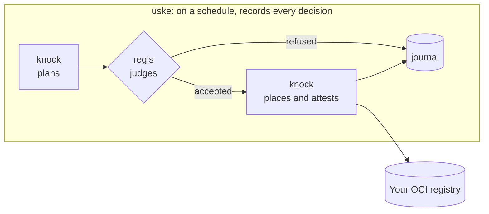
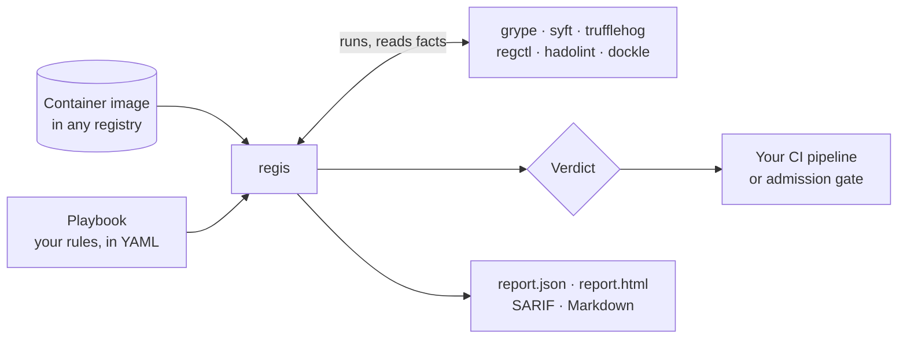

# regis

**Judge a container image against your own rules, and get a verdict you can replay.**

<!-- trio:begin -->
> **regis** says whether. **knock** does. **uske** beats time, and records.

Together they form an admission gate for container images. [knock](https://github.com/trivoallan/knock)
plans every import, update or rebuild; [regis](https://github.com/trivoallan/regis) judges each image
against a declarative playbook; knock applies only what was accepted; [uske](https://github.com/trivoallan/uske)
runs this screening on a schedule and records every decision.


<!-- trio:end -->

## Why

A pipeline refuses an image, and someone asks why. A scanner gives you four hundred CVEs and a red
badge. It cannot tell you which rule failed, against which threshold, or whether yesterday's run
would have said the same. So the person who wrote the pipeline gets the call, every time.

## What it does



- **Gathers facts** about an image from tools you already trust (`grype`, `syft`, `trufflehog`,
  `regctl`, `hadolint`, `dockle`), run in parallel.
- **Judges them against a playbook** you write in YAML, with JSON Logic criteria.
- **Explains every refusal**: the rule, the fact from the image, and the threshold it crossed.
- **Writes two reports**: `report.json` for machines, an HTML report for people (plus SARIF and
  Markdown).
- **Replays**: the same image and the same playbook give the same verdict, and the report says which
  playbook produced it.

## Quick start

Run it with Docker against a public image:

```bash
docker run --rm -v "$PWD:/out" ghcr.io/trivoallan/regis analyze alpine:latest --evaluate --html -D /out
```

Open `report.html`: the verdict, each rule that passed or failed, and the facts behind it. Next,
[write your own playbook](docs/usage/custom-playbook.md). In GitHub Actions, use the
[regis GitHub Action](https://github.com/trivoallan/regis-action).

## Is it for you?

**For you if** you must accept or refuse container images and be able to say why: in a CI
pipeline, or in front of a registry. regis needs neither knock nor uske.

**Not for you if** you only want a list of CVEs. Run `grype` or `trivy` directly: regis runs grype
too, but its job is the verdict, not the scan.

## Documentation

Everything lives in [`docs/`](docs/README.md):
[getting started](docs/usage/getting-started.md) ·
[concepts](docs/concepts/introduction.md) ·
[how-to guides](docs/usage/analyze-image.md) ·
[reference](docs/reference/cli.md) ·
[upgrade guides](docs/README.md#contents).

## Contributing

Issues and pull requests are welcome. Read [CONTRIBUTING.md](CONTRIBUTING.md) first.

## License

Apache License 2.0. See [LICENSE](LICENSE).
