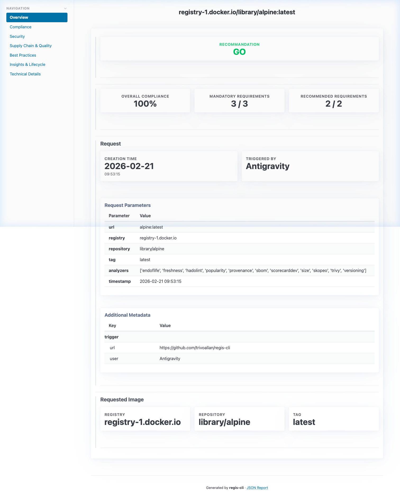
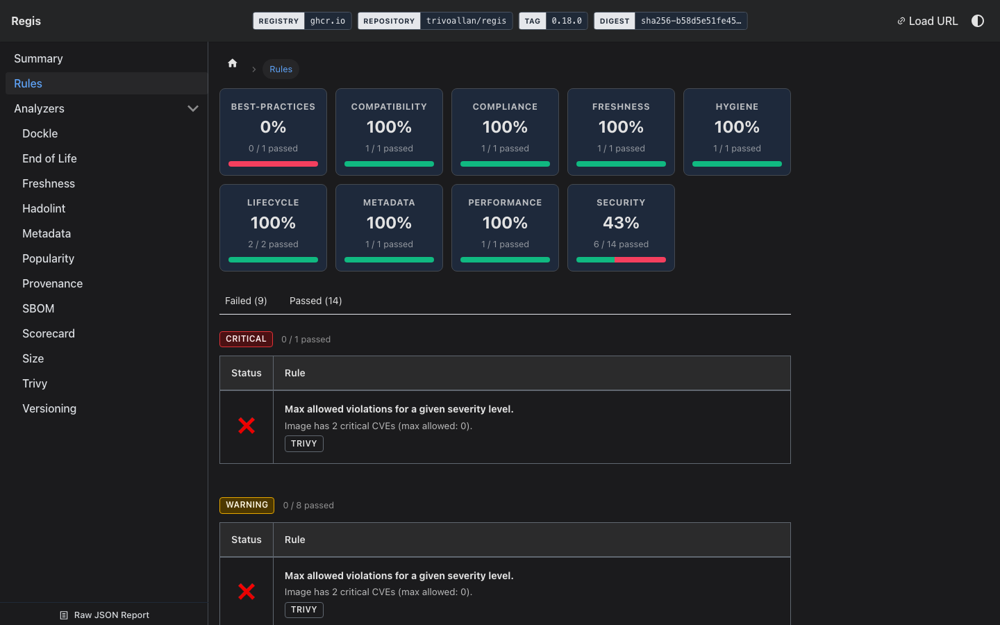
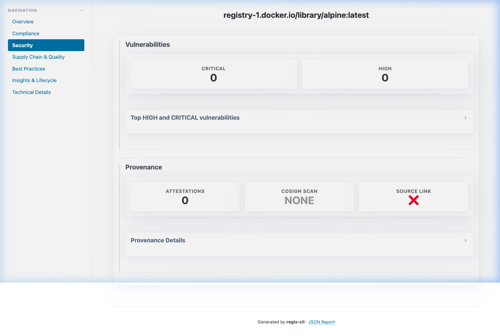
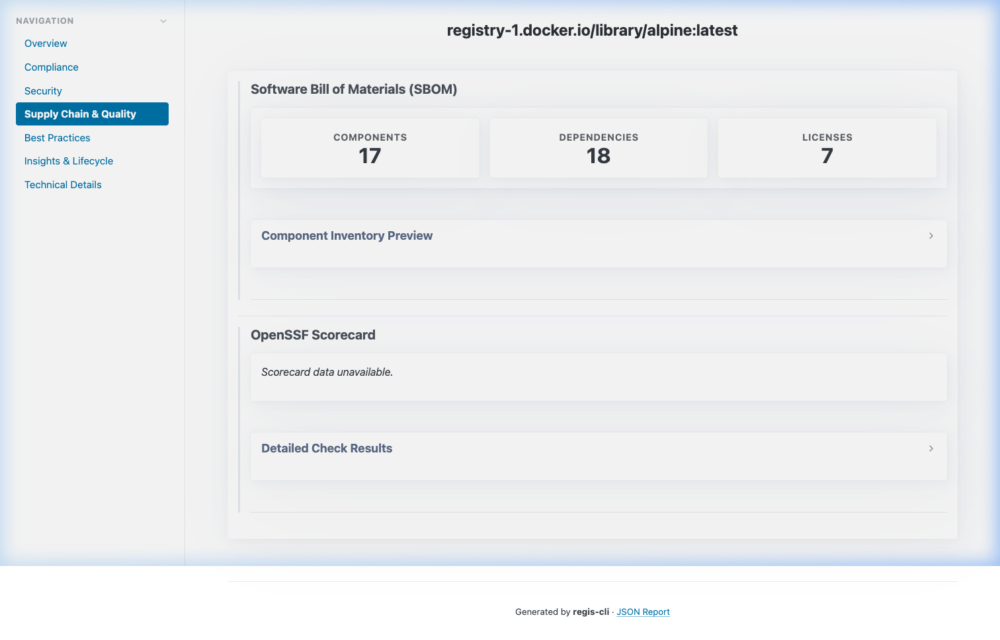
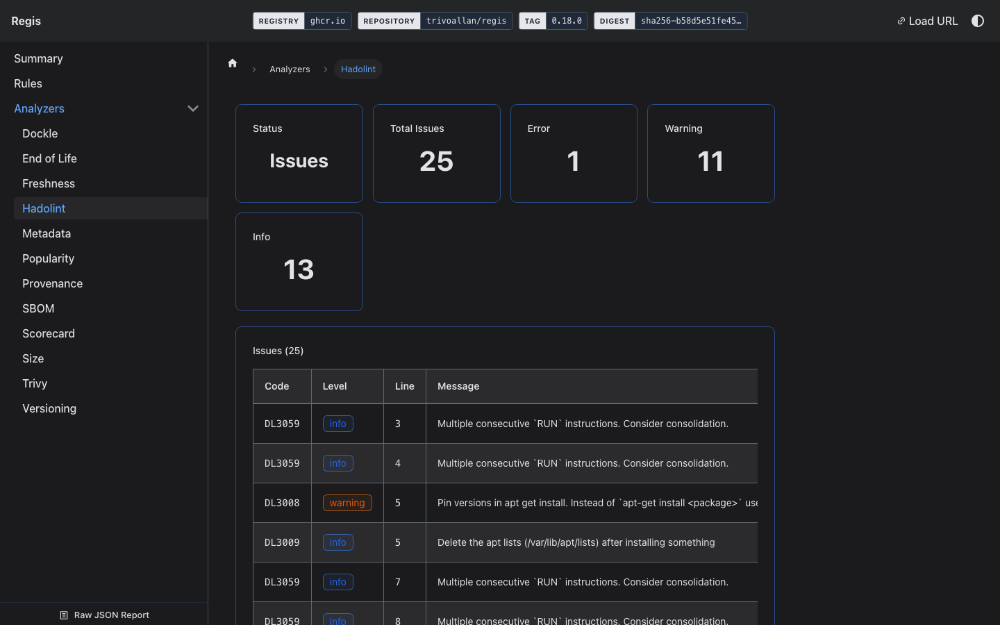
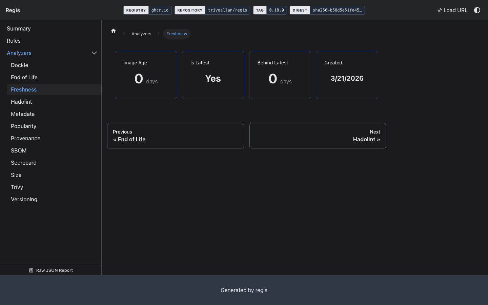
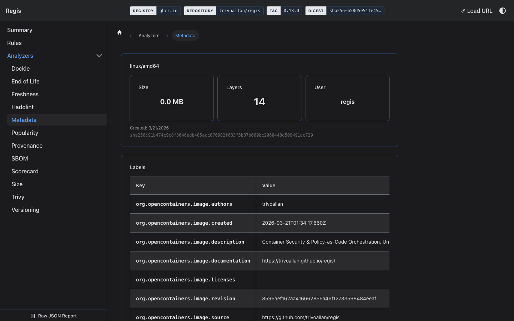

# regis documentation

**Container Security & Policy-as-Code Orchestration.**
Analyze container images, enforce compliance policies, and generate interactive security reports — all from a single CLI.

[Get Started →](./usage/getting-started.md)&nbsp;&nbsp;·&nbsp;&nbsp;[Default playbook →](../regis/playbooks/default/playbook.yaml)

## Contents

- **Usage**: [Getting Started](./usage/getting-started.md) · [Image Analysis](./usage/analyze-image.md) · [Advanced Configuration](./usage/configuration.md) · [Playbook customisation](./usage/custom-playbook.md) · [Registry Authentication](./usage/registries.md) · [Managing Analyzer Tools](./usage/tools-management.md) · [Troubleshooting](./usage/troubleshooting.md) · Integrations: [GitHub](./usage/integrations/github.md), [GitLab](./usage/integrations/gitlab.md)
- **Concepts**: [Introduction](./concepts/introduction.md) · [Analyzers](./concepts/analyzers.md) · [Playbooks](./concepts/playbooks.md) · [Rules and criteria](./concepts/rules.md) · [Scoring & Metrics](./concepts/scoring.md) · [Reports](./concepts/reports.md)
- **Reference**: [CLI](./reference/cli.md) · [Analyzers](./reference/analyzers/index.md) · [Rules](./reference/rules/README.md) · [Default playbook](./reference/playbooks/default/index.md) · [Playbook Versioning](./reference/playbook-versioning.md) · Schemas: [analyzer](./reference/schemas/analyzer/), [meta](./reference/schemas/meta/), [playbook](./reference/schemas/playbook/), [report](./reference/schemas/report/)
- **Upgrade guides**: [apiVersion/kind playbook format](./upgrade/playbook-schema-v1.md) · [`rule` to `criterion`](./upgrade/rule-to-criterion.md) · [Implicit default-rule inheritance](./upgrade/implicit-defaults-removal.md) · [Report metadata namespace](./upgrade/report-metadata-namespace.md) · [Metadata validation](./upgrade/metadata-validation-enforcement.md)

## Features

- **🔌 Pluggable Analyzers**: orchestrates grype, syft, trufflehog, regctl, Hadolint, Dockle and more via a unified plugin system. Run all analyzers in parallel in a single command.
- **📋 Policy-as-Code Playbooks**: define compliance and security rules in YAML using JSON Logic. Enforce image age, CVE thresholds, allowed registries, and more — no code required.
- **📊 Interactive HTML Reports**: rich, navigable dashboards with drill-down views per analyzer, generated alongside machine-readable JSON for automation.
- **🏗️ Multi-arch Support**: inspect any OCI-compliant registry across all architectures and platforms. Supports Docker Hub, GHCR, ECR, and private registries.
- **⚙️ CI/CD Native**: first-class GitHub Actions and GitLab CI integration. Attach HTML reports as artifacts and annotate PRs with policy results.
- **⚖️ License Compliance**: detect copyleft licenses (GPL, AGPL, LGPL…) across all SBOM components. Block non-compliant images before they reach production.

## Report Preview

### Dashboard

### Compliance

### Security

### Supply Chain

### Best Practices

### Insights

### Technical

